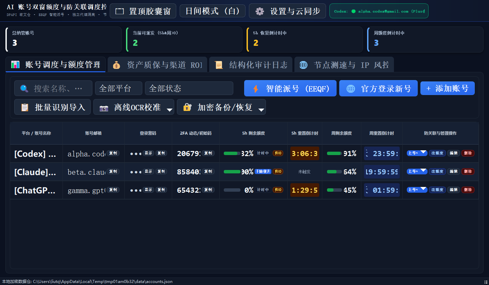
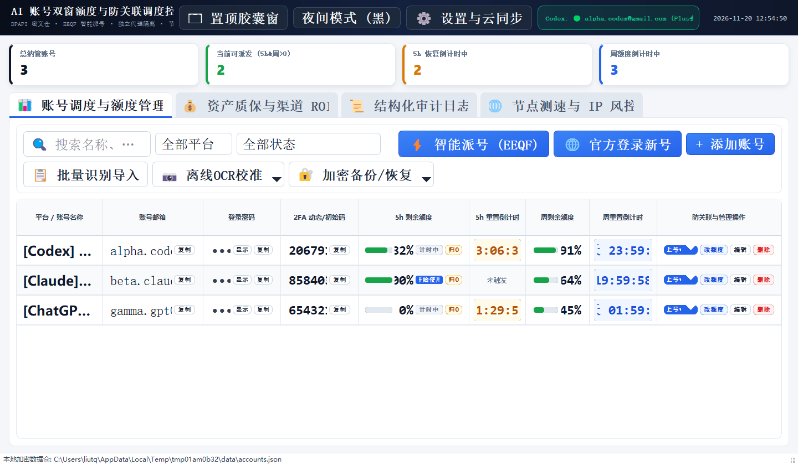
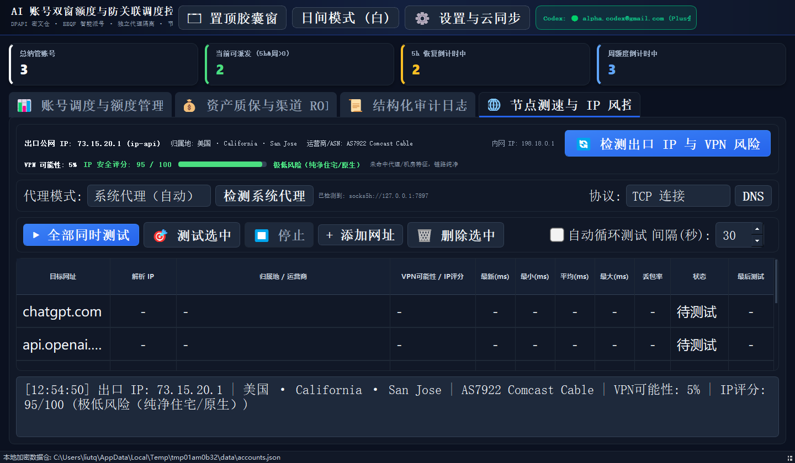

<div align="center">

# ⚡ AI 多平台账号双窗额度与防关联调度控制台 (v2.0)

**一站式纳管 ChatGPT / Claude / Codex / Custom 账号凭据 · 5h/周双时间窗防作废调度 · 系统 Codex 免密自动捕获与实时额度同步 · 节点测速与 VPN/IP 风控评分 · 离线 OCR 校准**

[](https://www.python.org/)
[](https://pypi.org/project/PyQt5/)
[](https://www.microsoft.com/windows)
[](tests/)
[](src/security.py)

</div>

---

## ✨ 界面预览 (UI Showcase)

### 🌙 夜间深邃模式（主调度控制台）


### ☀️ 日间护眼模式（卡片投影 & 双层工具栏）


### 🌐 节点测速与 VPN / IP 纯净度风控看板


---

## 🚀 核心功能特性

### 1. 系统 Codex 免密自动捕获与实时额度同步 (`src/codex_detector.py`)
- **全账号自动保留**：后台通过 `QFileSystemWatcher` 实时监测 `~/.codex/auth.json` 变更；每次登录新账号即自动解析 JWT Claims（邮箱、昵称、Plus/Team/Pro 订阅计划与官方到期日），自动建档并将凭据通过 DPAPI 加密归档至 `data/codex_vault/`，切换账号绝不覆盖丢失历史数据。
- **官方登录向导 (`⚡ 官方登录新号`)**：一键调起官方 OAuth 浏览器登录流，授权完成后毫秒级自动捕获全部信息并入库，**零手动录入**。
- **5 小时 / 周额度实时同步**：自动读取 `~/.codex/sessions/**/*.jsonl` 中的 `rate_limits` 遥测数据，按 `account_id` / `user_id` 严格跨号隔离，实时同步 5h 剩余百分比、周剩余百分比及精准重置倒计时。

### 2. 节点测速与 VPN 可能性 / IP 纯净度打分 (`src/network_lab.py`)
- **四协议并发测速**：支持 **TCP 连接**、**系统 Ping (ICMP)**、**HTTP(S) 响应**、**DNS 查询**（代理下自动切换为 TCP DNS 隧道）；支持直连、Windows 系统代理自动检测（支持 `http` / `socks5` / `socks5h`）、手动代理及一键载入账号独立代理。
- **VPN 可能性 & IP 安全评分 (0–100 分，分数越高风险越低)**：
  - 穿透当前代理查询真实出口公网 IP、归属国家/地区、城市、ISP 与 ASN。
  - 结合代理/Tor 出口标记、数据中心 VPS 段、ASN/rDNS 关键词及 AI 平台受限区域综合评分，直观评估节点是否为商业 VPN / 机房 IP 或纯净住宅原生链路。

### 3. 双时间窗防作废智能派号引擎 (`EEQF`)
- 综合 **周剩余额度**、**周重置剩余时间** 与 **账号健康权重** 计算防作废紧急度评分：
  $$U_i = \frac{Q_{\text{weekly}}}{\max(h_{\text{left}}, 1.0)} \times W_{\text{health}}$$
- 按 `Ctrl+Shift+D` 一键派发最紧急可用账号，自动校验周额度余额并开启 5h 倒计时，同步装载三段式上号吐码队列。

### 4. Chromium 独立隔离启动 + 三段式顺序吐码 + TOTP 防过期 (`src/launcher.py`)
- 为每个账号生成独立 `--user-data-dir` 与独立 `--proxy-server`（拦截参数注入），物理隔离多号 Cookie 与出口 IP。
- 三段式顺序吐码（`1.邮箱 -> 2.密码 -> 3.动态2FA`）：当 6 位 TOTP 剩余有效期 `<= 3s` 时自动顺延等待新周期码再写入剪贴板，并在粘贴后按设定秒数自动执行剪贴板**阅后即焚**。

### 5. 零网络离线 OCR 校准 + 置顶胶囊窗 + 端到端加密云同步
- **离线 WinRT OCR (`src/ocr_sync.py`)**：调用 Windows 10/11 原生 `Windows.Media.Ocr`，支持全屏橡皮筋框选、剪贴板截图 (`Win+Shift+S`) 与本地图片识别，自动换算“已用% / 剩余%”与周重置倒计时。
- **Mini HUD 置顶胶囊窗 (`src/mini_hud.py`)**：`356 × 106 px` 无边框置顶浮窗，支持一键派号、步进吐码与框选 OCR。
- **DPAPI + AES-256-GCM 端到端加密**：本地凭据通过 Windows DPAPI 绑定系统用户透明加密；跨设备备份与 WebDAV 同步采用 `PBKDF2-HMAC-SHA256 (600,000 轮) + AES-256-GCM`。
- **资产质保与渠道 ROI 账本**：按卡商渠道统计存活率、翻车率与单次 5h 产出成本，一键生成标准化异常号售后凭条，支持 Windows 计划任务离线静默 Toast 提醒。

---

## 📦 快速开始与源码构建

```powershell
# 1. 克隆仓库并安装依赖
git clone https://github.com/liutq25/gpt-account-manager.git
cd gpt-account-manager
pip install -r requirements.txt

# 2. 启动图形界面
python main.py

# 3. 运行全量单元测试与对抗测试套件 (66 项)
python -m pytest tests/ -v

# 4. 打包为单文件绿色 EXE
python -m PyInstaller --clean --noconfirm "GPT管理助手.spec"
```

---

## 📁 项目结构

```text
├── main.py                      # 应用入口（支持 GUI 与 --check-notify 离线静默巡检模式）
├── GPT管理助手.spec              # PyInstaller 单文件打包配置
├── src/
│   ├── models.py                # 账号模型、EEQF 调度算法、TOTP 安全窗口、ROI 统计
│   ├── security.py              # Windows DPAPI 加解密、PBKDF2+AES-256-GCM 跨端加密、WebDAV 同步
│   ├── storage.py               # 原子落盘存储、结构化 JSONL 审计日志、Windows 计划任务集成
│   ├── codex_detector.py        # Codex auth.json 实时监测、JWT 解析、OAuth 登录与遥测额度同步
│   ├── network_lab.py           # 多协议测速引擎、HTTP/SOCKS5 代理隧道、VPN/IP 风险评分引擎
│   ├── network_widget.py        # 「节点测速与 IP 风控」PyQt5 交互界面
│   ├── launcher.py              # Chromium 隔离启动器与三段式顺序吐码状态机
│   ├── ocr_sync.py              # Windows 原生 WinRT OCR 引擎与 ~/.codex/auth.json 热切换器
│   ├── mini_hud.py              # 置顶微型悬浮胶囊窗与全屏框选截图器
│   ├── dialogs.py               # 账号录入/批量导入/Codex登录/OCR回填/系统设置弹窗群
│   ├── ui_styles.py             # 现代日间/夜间双主题设计系统与 QSS 样式引擎
│   └── main_window.py           # 主调度控制台与系统托盘集成
├── tests/                       # 全量单元测试、混沌对抗测试与集成测试 (66 passed)
└── assets/                      # 应用图标与界面预览截图
```
